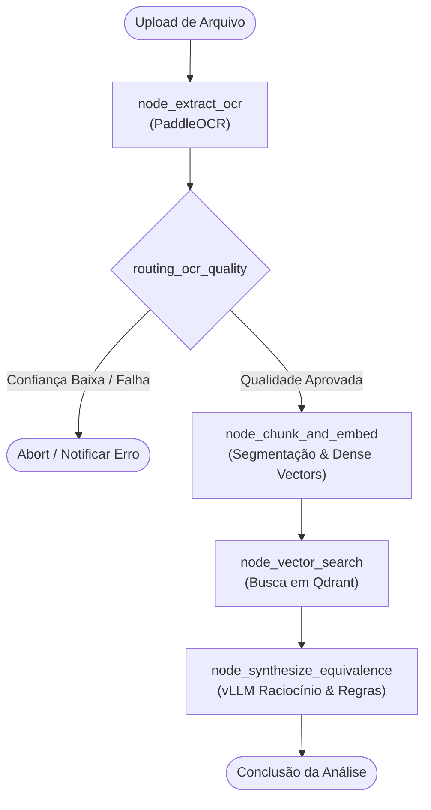

# Motor de Equivalência Semântica de Documentos (Graph-Based)

<div align="center">


<p>Motor de extração assíncrona, busca vetorial densa e grafo de raciocínio baseado em <b>LangGraph</b> para identificação e auditoria de equivalência semântica e legal entre documentos corporativos.</p>

</div>

---

## 🏗️ Visão Geral & Arquitetura

O sistema implementa um pipeline distribuído em conformidade estrita com os princípios de **Clean Architecture** e **Domain-Driven Design (DDD)**. Ele desacopla drivers de infraestrutura (PaddleOCR para digitalização, Qdrant para recuperação vetorial e vLLM para raciocínio com LLMs) da lógica nuclear de equivalência contratual.

### Topologia do Grafo LangGraph



---

## 🏛️ Clean Architecture: Estrutura em Camadas

### 1. Ordem de Escrita (de dentro pra fora)

| Ordem | Camada | Arquivo(s) | Por quê essa ordem |
|---|---|---|---|
| 1 | Domínio / Enums & Entidades | `backend/app/core/domain/enum/document_status.py`<br/>`backend/app/core/domain/models/document.py` | Entidades puras e imutáveis. Não dependem de nenhuma biblioteca de terceiros, frameworks ou drivers. |
| 2 | Domínio / Portas & Gateways | `backend/app/core/domain/gateway/ocr_gateway.py`<br/>`backend/app/core/domain/gateway/vector_store_gateway.py`<br/>`backend/app/core/domain/gateway/llm_gateway.py` | Define as interfaces abstratas requeridas pelo negócio sem implementar detalhes tecnológicos. |
| 3 | Aplicação / Casos de Uso & LangGraph | `backend/app/core/usecase/semantic_graph/state.py`<br/>`backend/app/core/usecase/semantic_graph/nodes.py`<br/>`backend/app/core/usecase/semantic_graph/edges.py`<br/>`backend/app/core/usecase/semantic_graph/graph.py`<br/>`backend/app/core/usecase/evaluate_equivalence_usecase.py` | Orquestra as regras de negócio através das portas de domínio, desacoplado de banco de dados ou HTTP. |
| 4 | Infraestrutura / Adaptadores Concretos | `backend/app/infrastructure/gateway/paddle_ocr_impl.py`<br/>`backend/app/infrastructure/gateway/qdrant_vector_store_impl.py`<br/>`backend/app/infrastructure/gateway/vllm_client_impl.py`<br/>`backend/app/infrastructure/config/settings.py` | Implementa as portas utilizando SDKs concretos (PaddleOCR, Qdrant REST/gRPC e vLLM). |
| 5 | Apresentação / API & Controllers | `backend/app/presentation/dtos/document_dto.py`<br/>`backend/app/presentation/api/v1/controllers/equivalence_controller.py`<br/>`backend/app/presentation/api/v1/router.py`<br/>`backend/main.py` | Expõe endpoints RESTful FastAPI, valida payloads de entrada e traduz resultados para o usuário. |
| 6 | Frontend / Angular 17+ Standalone | `frontend/src/app/domain/models/document-equivalence.model.ts`<br/>`frontend/src/app/infrastructure/api/equivalence-api.service.ts`<br/>`frontend/src/app/presentation/pages/dashboard/dashboard.component.ts` | Interface gráfica reativa e tipada para upload, visualização de scores e divergências. |

### 2. Ordem de Leitura (de fora pra dentro)

| Ordem | Pergunta que você está respondendo | Arquivo(s) |
|---|---|---|
| 1 | Que entrada HTTP existe e o que ela expõe? | `backend/app/presentation/api/v1/router.py` |
| 2 | Como a requisição é interceptada e orquestrada? | `backend/app/presentation/api/v1/controllers/equivalence_controller.py` |
| 3 | O que o caso de uso manda executar de fato? | `backend/app/core/usecase/evaluate_equivalence_usecase.py` |
| 4 | Qual a máquina de estados e fluxo do grafo de IA? | `backend/app/core/usecase/semantic_graph/graph.py` |
| 5 | Com quais contratos o caso de uso trabalha? | `backend/app/core/domain/gateway/*` + `backend/app/core/domain/models/document.py` |
| 6 | Como esses contratos são cumpridos de verdade? | `backend/app/infrastructure/gateway/*` |

---

## 🐳 Execução via Docker Compose

```bash
# Inicializar toda a infraestrutura (Backend, Frontend, Qdrant, OpenTelemetry)
docker compose up --build -d

# Visualizar logs em tempo real
docker compose logs -f
```

### Portas e Serviços:
- **Frontend Angular 17+:** [http://localhost:4200](http://localhost:4200)
- **FastAPI Backend:** [http://localhost:8000](http://localhost:8000)
- **Documentação Interativa Swagger:** [http://localhost:8000/docs](http://localhost:8000/docs)
- **Qdrant Vector Dashboard:** [http://localhost:6333/dashboard](http://localhost:6333/dashboard)
- **OpenTelemetry Collector OTLP:** `localhost:4317` (gRPC) / `localhost:4318` (HTTP)

---

## 🧪 Executando Testes Unitários e de Integração

```bash
cd backend
python -m venv .venv
source .venv/bin/activate
pip install -r requirements.txt
pytest tests/ -v
```

---

## 📄 Licença

Distribuído sob a licença MIT. Consulte `LICENSE` para mais detalhes.
